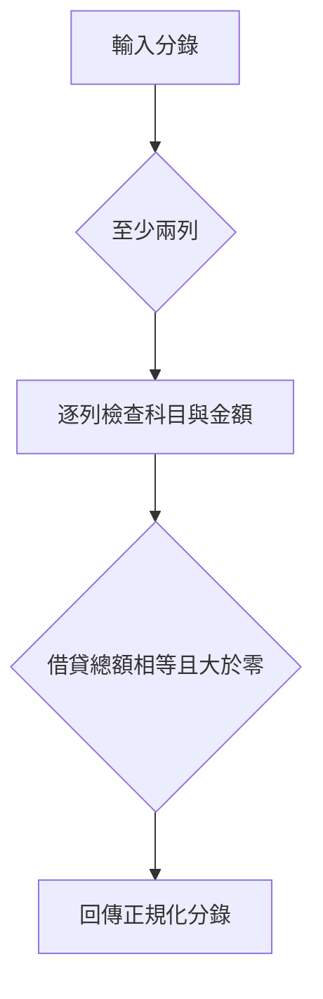
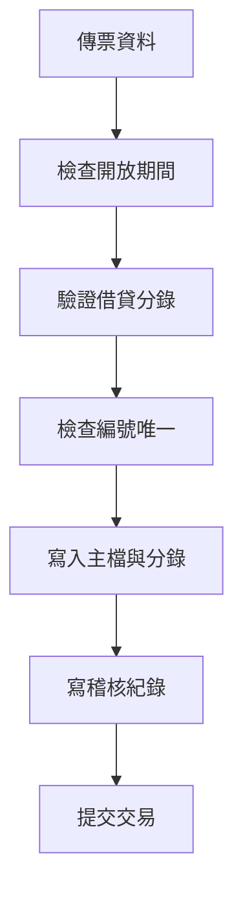
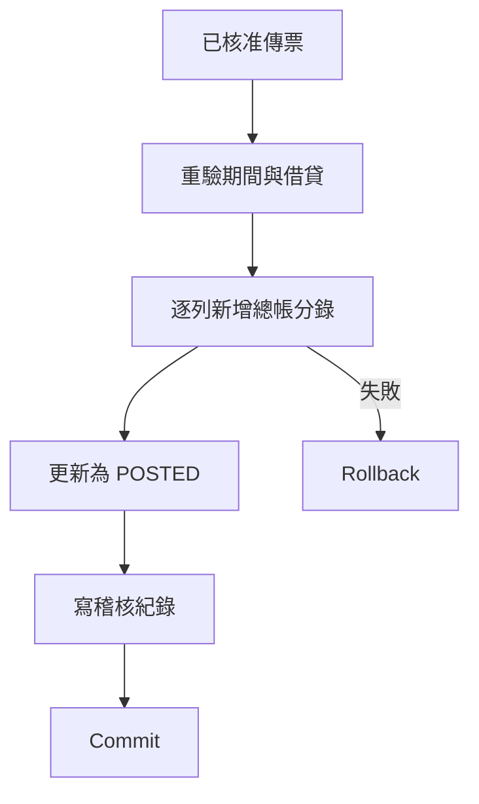
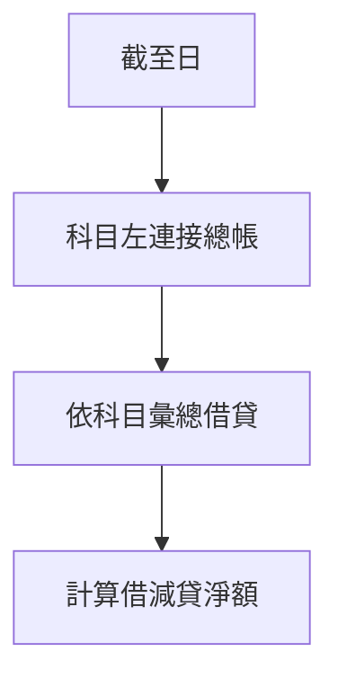
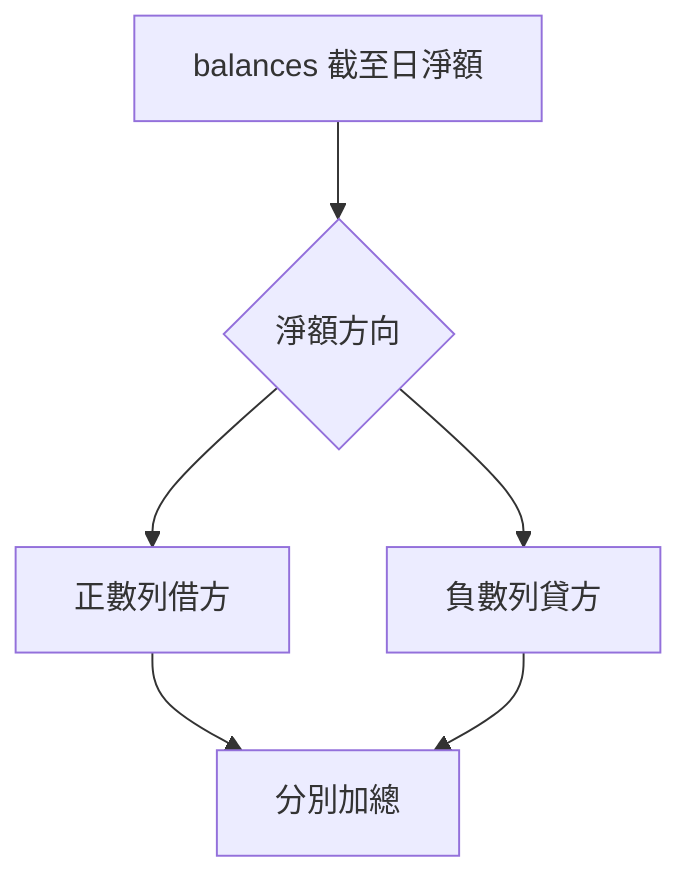
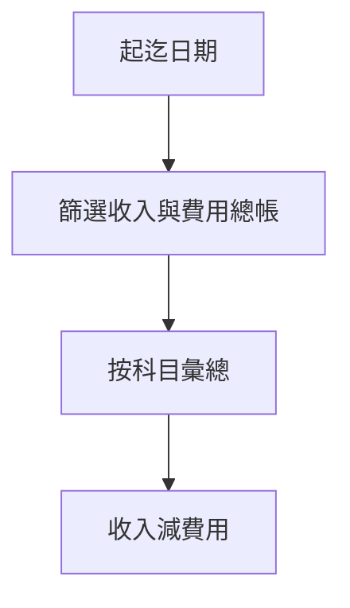
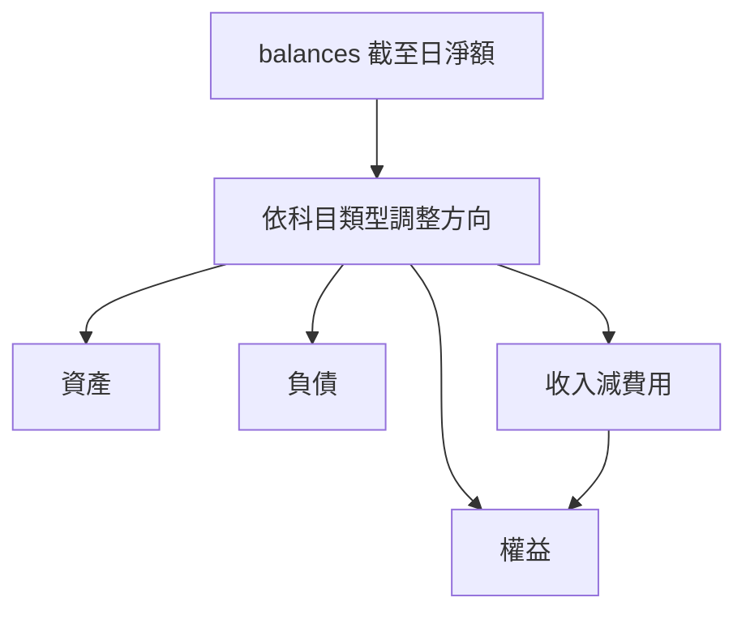

# GL Accounting System 知識庫預覽

Project ID：2

下列程式碼從目前 Repository 原檔擷取。各段均沒有手寫 SQL，因此不另建 SQL Snippet。

## validate_lines()：分錄與借貸平衡驗證

來源：`app/services.py:47` 至第 70 行
Feature ID：51；將新增

### 原始碼

```python
def validate_lines(lines):
    if len(lines) < 2:
        raise BusinessError("TOO_FEW_LINES", "傳票至少需要兩列分錄")
    debit = credit = 0
    normalized = []
    for row in lines:
        try:
            account_id = int(row["account_id"])
            account = db.session.get(Account, account_id)
            d, c = money_minor(row.get("debit", "0")), money_minor(row.get("credit", "0"))
        except (KeyError, TypeError, ValueError):
            raise BusinessError("INVALID_LINE", "分錄科目或金額不完整")
        if not account or not account.active or not account.postable or db.session.scalar(
            select(func.count()).select_from(Account).where(Account.parent_id == account_id)
        ):
            raise BusinessError("INVALID_ACCOUNT", "僅啟用的可過帳葉節點科目可用於傳票")
        if (d > 0) == (c > 0):
            raise BusinessError("INVALID_LINE", "每列只能在借方或貸方填入正數")
        debit += d
        credit += c
        normalized.append((account_id, str(row.get("description", "")), d, c))
    if debit != credit or debit == 0:
        raise BusinessError("VOUCHER_UNBALANCED", "借貸金額不平衡")
    return normalized
```

### 技術說明

先要求至少兩列，再逐列以 Decimal 轉換金額為整數分，檢查科目存在、啟用、可過帳且沒有子科目。每列借貸只能一側為正數；最後要求總借方等於總貸方且大於零。錯誤以 BusinessError 中斷。

### 業務說明

防止不平衡、零金額或無效科目的傳票進入保存與過帳流程。

### 資料表引用

- `accounts`：查詢科目啟用、可過帳及是否有子科目

### 流程圖



## save_voucher()：建立或修改傳票草稿

來源：`app/services.py:73` 至第 108 行
Feature ID：51；將新增

### 原始碼

```python
def save_voucher(data, actor_id, voucher=None, commit=True):
    if voucher and voucher.status != "DRAFT":
        raise BusinessError("INVALID_STATUS", "只能修改草稿傳票", 409)
    voucher_date = parse_date(data.get("voucher_date"))
    try:
        period_id = int(data.get("period_id"))
    except (TypeError, ValueError):
        raise BusinessError("INVALID_PERIOD", "請選擇會計期間")
    open_period(period_id, voucher_date)
    lines = validate_lines(data.get("lines", []))
    number = str(data.get("voucher_no", "")).strip()
    if not number or not str(data.get("description", "")).strip():
        raise BusinessError("REQUIRED_FIELD", "傳票編號及摘要不可空白")
    existing = db.session.scalar(select(Voucher).where(Voucher.voucher_no == number))
    if existing and (not voucher or existing.id != voucher.id):
        raise BusinessError("DUPLICATE_VOUCHER", "傳票編號已存在", 409)
    if voucher is None:
        voucher = Voucher(created_by=actor_id)
        db.session.add(voucher)
    voucher.voucher_no = number
    voucher.voucher_date = voucher_date
    voucher.period_id = period_id
    voucher.description = str(data["description"]).strip()
    if voucher.id:
        for old_line in list(voucher.lines):
            db.session.delete(old_line)
        db.session.flush()
    voucher.lines.clear()
    for i, (account_id, description, debit, credit) in enumerate(lines, 1):
        voucher.lines.append(VoucherLine(line_no=i, account_id=account_id,
                                         description=description, debit_minor=debit, credit_minor=credit))
    db.session.flush()
    log(actor_id, "SAVE", "voucher", voucher.id, after={"status": voucher.status})
    if commit:
        db.session.commit()
    return voucher
```

### 技術說明

若修改既有傳票，先限制狀態為 DRAFT。解析日期及期間、驗證分錄與編號唯一性後，寫入 vouchers 與 voucher_lines；修改時刪除舊分錄再建立新分錄。新增 SAVE 稽核紀錄，commit=True 時提交交易。

### 業務說明

將通過後端會計規則的傳票保存為可送審草稿，並留下操作者紀錄。

### 資料表引用

- `vouchers`：保存傳票主檔、日期、期間與狀態
- `voucher_lines`：保存逐列借貸分錄
- `audit_logs`：記錄 SAVE 操作

### 流程圖



## post_voucher()：原子過帳與失敗回滾

來源：`app/services.py:131` 至第 149 行
Feature ID：51；將新增

### 原始碼

```python
def post_voucher(voucher, actor_id):
    if voucher.status != "APPROVED":
        raise BusinessError("INVALID_STATUS", "只有已核准傳票可過帳", 409)
    open_period(voucher.period_id, voucher.voucher_date)
    validate_lines([{"account_id": line.account_id, "debit": Decimal(line.debit_minor) / 100,
                     "credit": Decimal(line.credit_minor) / 100} for line in voucher.lines])
    try:
        for line in voucher.lines:
            db.session.add(LedgerEntry(voucher_line_id=line.id, voucher_id=voucher.id,
                account_id=line.account_id, entry_date=voucher.voucher_date, period_id=voucher.period_id,
                debit_minor=line.debit_minor, credit_minor=line.credit_minor))
        voucher.status = "POSTED"
        voucher.posted_at = datetime.now(timezone.utc)
        log(actor_id, "POST", "voucher", voucher.id, {"status": "APPROVED"}, {"status": "POSTED"})
        db.session.commit()
    except Exception:
        db.session.rollback()
        raise
    return voucher
```

### 技術說明

只接受 APPROVED 傳票；重新檢查期間與分錄。對每列 VoucherLine 建立一筆 LedgerEntry，接著將傳票設為 POSTED、記錄 UTC 過帳時間與 POST 稽核紀錄，最後在同一 DB session 提交。任何例外都 rollback 並重新拋出。ledger_entries.voucher_line_id 的唯一約束提供重複寫入防護。

### 業務說明

核准後才讓分錄進入正式總帳；過帳失敗不留下部分入帳結果。

### 資料表引用

- `vouchers`：檢查並更新過帳狀態
- `voucher_lines`：取得待過帳分錄
- `ledger_entries`：建立正式總帳分錄；voucher_line_id 唯一
- `audit_logs`：記錄 POST 操作

### 流程圖



## balances()：截至日科目餘額來源

來源：`app/services.py:168` 至第 173 行
Feature ID：52；將新增

### 原始碼

```python
def balances(as_of):
    rows = db.session.execute(select(Account, func.coalesce(func.sum(LedgerEntry.debit_minor), 0),
        func.coalesce(func.sum(LedgerEntry.credit_minor), 0)).outerjoin(
        LedgerEntry, (Account.id == LedgerEntry.account_id) & (LedgerEntry.entry_date <= as_of)
    ).group_by(Account.id).order_by(Account.code)).all()
    return [{"account": a, "debit": int(d), "credit": int(c), "net": int(d-c)} for a, d, c in rows]
```

### 技術說明

以 accounts 左連接 ledger_entries，條件限定 entry_date 不晚於截至日；依科目彙總借方與貸方整數分，將差額 debit-credit 作為 net。外連接讓沒有分錄的科目仍出現在中間結果。

### 業務說明

提供試算表及資產負債表一致的截至日餘額基礎，報表只取正式總帳資料。

### 資料表引用

- `accounts`：列出科目與類型
- `ledger_entries`：累計截至日已過帳借貸發生額

### 流程圖



## trial_balance()：試算表借貸餘額

來源：`app/services.py:176` 至第 183 行
Feature ID：52；將新增

### 原始碼

```python
def trial_balance(as_of):
    rows = []
    for b in balances(as_of):
        if b["net"]:
            rows.append({"code": b["account"].code, "name": b["account"].name,
                         "debit_minor": max(b["net"], 0), "credit_minor": max(-b["net"], 0)})
    return {"rows": rows, "debit_minor": sum(x["debit_minor"] for x in rows),
            "credit_minor": sum(x["credit_minor"] for x in rows)}
```

### 技術說明

呼叫 balances(as_of) 取得各科目借減貸淨額，排除零餘額；正數列入借方餘額，負數取絕對值列入貸方餘額，最後分別加總。

### 業務說明

在指定截至日檢查各科目借貸餘額總和是否相等；相等只代表借貸平衡，不保證所有帳務分類正確。

### 資料表引用

- 此函式透過其他函式取得資料；本段沒有直接 ORM 資料表引用。

### 流程圖



## income_statement()：期間損益計算

來源：`app/services.py:186` 至第 199 行
Feature ID：52；將新增

### 原始碼

```python
def income_statement(start, end):
    if start > end:
        raise BusinessError("INVALID_DATE", "起日不可晚於迄日")
    rows = db.session.execute(select(Account, func.coalesce(func.sum(LedgerEntry.debit_minor), 0),
        func.coalesce(func.sum(LedgerEntry.credit_minor), 0)).join(
        LedgerEntry, Account.id == LedgerEntry.account_id).where(
        LedgerEntry.entry_date.between(start, end), Account.type.in_(["REVENUE", "EXPENSE"])
    ).group_by(Account.id).order_by(Account.code)).all()
    result = [{"code": a.code, "name": a.name, "type": a.type,
               "amount_minor": int(c-d if a.type == "REVENUE" else d-c)} for a, d, c in rows]
    revenue = sum(x["amount_minor"] for x in result if x["type"] == "REVENUE")
    expense = sum(x["amount_minor"] for x in result if x["type"] == "EXPENSE")
    return {"rows": result, "revenue_minor": revenue, "expense_minor": expense,
            "profit_minor": revenue-expense}
```

### 技術說明

先檢查起日不晚於迄日。查詢日期範圍內的 ledger_entries，只取 REVENUE 與 EXPENSE 科目並按科目彙總；收入以貸減借、費用以借減貸計算，最後以收入減費用得到本期損益。

### 業務說明

顯示指定期間的收入、費用與損益，避免把期外分錄列入本期。

### 資料表引用

- `accounts`：篩選收入與費用類型科目
- `ledger_entries`：查詢期間內已過帳分錄

### 流程圖



## balance_sheet()：截至日資產負債與未結轉損益

來源：`app/services.py:202` 至第 215 行
Feature ID：52；將新增

### 原始碼

```python
def balance_sheet(as_of):
    entries = balances(as_of)
    totals = {t: 0 for t in ("ASSET", "LIABILITY", "EQUITY", "REVENUE", "EXPENSE")}
    rows = []
    for b in entries:
        a = b["account"]
        value = b["net"] if a.type in ("ASSET", "EXPENSE") else -b["net"]
        totals[a.type] += value
        if value and a.type in ("ASSET", "LIABILITY", "EQUITY"):
            rows.append({"code": a.code, "name": a.name, "type": a.type, "amount_minor": value})
    profit = totals["REVENUE"] - totals["EXPENSE"]
    return {"rows": rows, "asset_minor": totals["ASSET"],
            "liability_minor": totals["LIABILITY"], "equity_minor": totals["EQUITY"] + profit,
            "unclosed_profit_minor": profit}
```

### 技術說明

呼叫 balances(as_of) 取得累計淨額，依科目類型調整正常餘額方向。資產、負債、權益列成明細；收入減費用得到未結轉損益，再加到權益總額。

### 業務說明

呈現截至日資產、負債及包含本期未結轉損益的權益，支援尚未製作收入費用結轉傳票的第一版流程。

### 資料表引用

- 此函式透過其他函式取得資料；本段沒有直接 ORM 資料表引用。

### 流程圖


