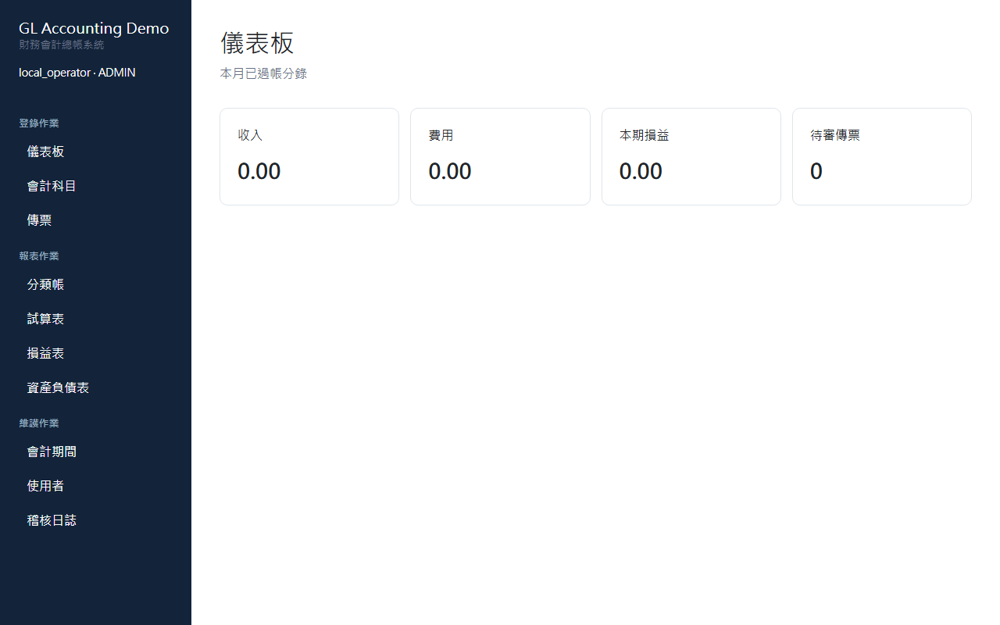
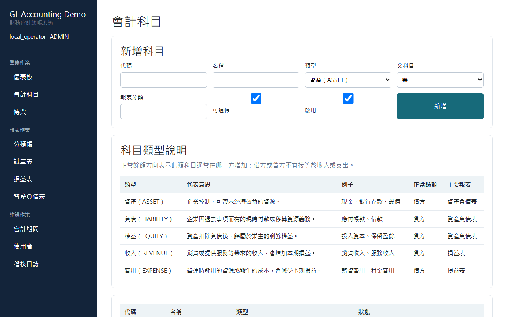
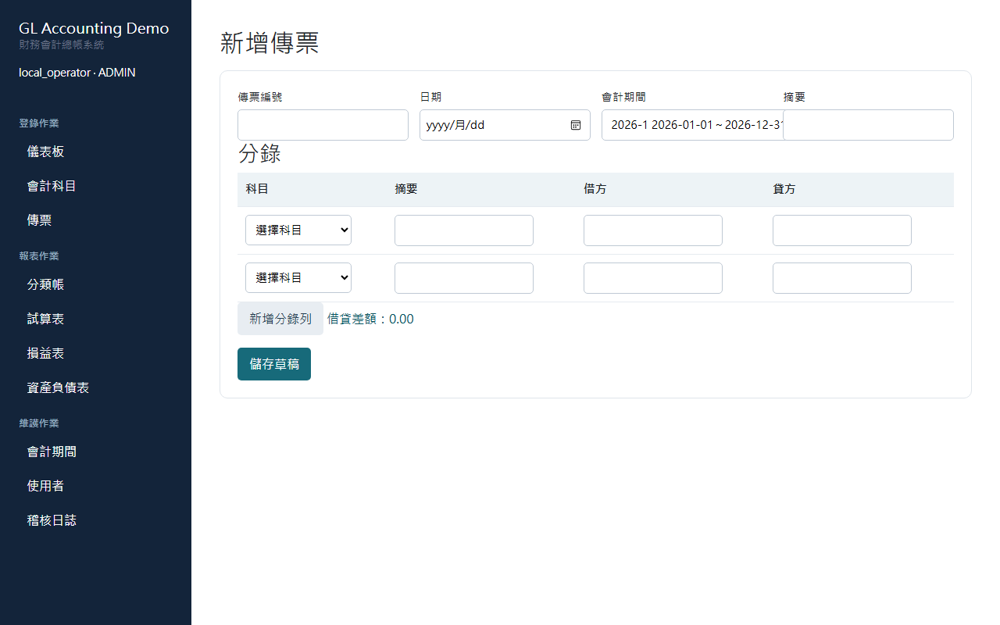
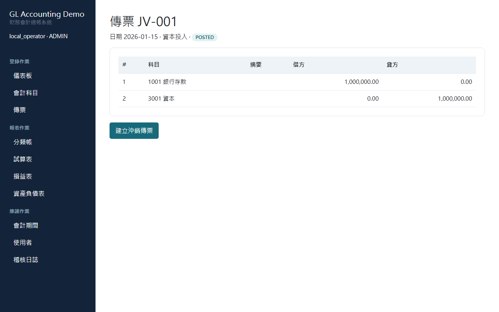
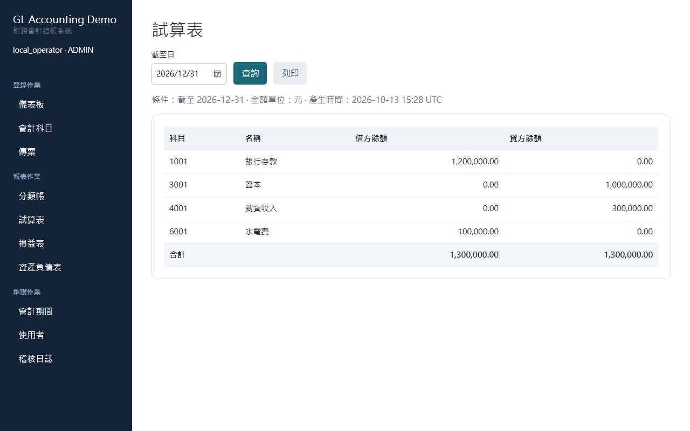
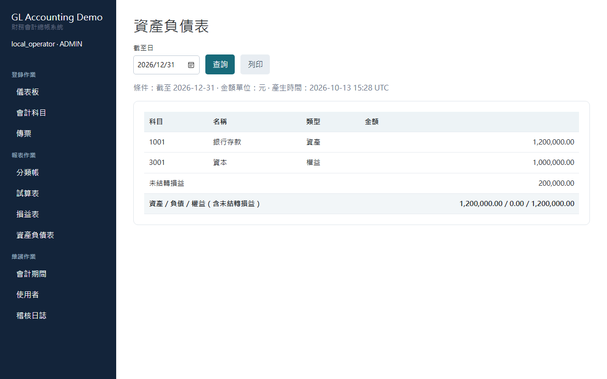

# 財務會計總帳系統 視覺化操作流程指引

> **參考規格**：本手冊參照極簡視覺化操作架構（參考範例：[HELLO.webp](HELLO.webp)），採用清晰的步驟圖文排版（Step 1 ～ Step 5），搭配各階段實際系統畫面與精確重點說明，讓新進會計與管理人員能一目了然、迅速上手。

---

```
┌──────────────┐     ┌──────────────┐     ┌──────────────┐     ┌──────────────┐     ┌──────────────┐
│  步驟 1      │ ──> │  步驟 2      │ ──> │  步驟 3      │ ──> │  步驟 4      │ ──> │  步驟 5      │
│  啟動與儀表板 │     │  科目與期間  │     │  新增傳票分錄│     │  審核與過帳  │     │  財務報表產出│
└──────────────┘     └──────────────┘     └──────────────┘     └──────────────┘     └──────────────┘
```

---

## 1. 系統啟動與儀表板總覽 (Dashboard Overview)



* **操作目的**：啟動財務系統並即時掌握營運與審核狀態。
* **操作要點**：
  1. 雙擊執行根目錄之 `啟動財務系統.bat`（或執行 `python run.py`），系統將自動啟動並在瀏覽器開啟 `http://127.0.0.1:8765/`。
  2. 登入後首頁為「儀表板」，上方資訊卡即時呈現本月已過帳之**收入**、**費用**、**本期損益**以及當前**待審傳票數量**。
  3. 左側導覽列提供「登錄作業」、「報表作業」與「維護作業」三大核心模組切換。

---

## 2. 會計科目與會計期間維護 (Chart of Accounts & Periods)



* **操作目的**：建立公司標準會計科目表，確保分錄可正確歸類並決定正常餘額方向。
* **操作要點**：
  1. 點選左側「**會計科目**」，可檢視全公司科目代碼、名稱、五大要素類型（資產 `ASSET`、負債 `LIABILITY`、權益 `EQUITY`、收入 `REVENUE`、費用 `EXPENSE`）及可否過帳屬性。
  2. 點擊「新增科目」可建立子科目（支援階層防呆，不可循環參照；且已使用科目不允許任意竄改類型）。
  3. 進入「**會計期間**」，確認當前作業年度與期別狀態為 `OPEN`；若期間已關閉（`CLOSED`），系統將嚴格禁止新增或過帳該期間之傳票。

---

## 3. 新增傳票分錄與借貸平衡檢核 (Voucher Entry)



* **操作目的**：錄入日常會計交易傳票，嚴格落實複式簿記原則。
* **操作要點**：
  1. 點選左側「**傳票**」後點擊「**新增傳票**」。
  2. 輸入**傳票編號**（如 `JV-202601-001`）、**交易日期**、選擇所屬**會計期間**並填寫**摘要**。
  3. 新增借方與貸方分錄明細：
     - 選擇具備過帳權限之明細科目。
     - 輸入金額（系統以元為單位顯示，後端自動以整數分儲存防範浮點數誤差）。
  4. 畫面即時動態計算「**借貸差額**」，唯有借貸完全平衡（差額為 `0.00`）且至少兩筆分錄時方可儲存為**草稿（DRAFT）**。

---

## 4. 傳票送審、核准、過帳與沖銷 (Workflow & Immutability)



* **操作目的**：執行多角色分工審核、寫入不可竄改之總帳，並支援合規之反向沖銷機制。
* **操作流程狀態機**：
  ```
  [草稿 DRAFT] ──(送審)──> [待審 SUBMITTED] ──(核准)──> [已核准 APPROVED] ──(過帳)──> [已過帳 POSTED]
        │                        │
        └──────(退回草稿)─────────┴──(駁回)──> [已駁回 REJECTED]
  ```
* **操作要點**：
  1. **送審與核准**：會計人員建立草稿後點擊「送審」；具備主管權限者點擊「核准」（若有疑慮可點擊「駁回」）。
  2. **過帳（Post）**：核准後執行「過帳」，系統在單一資料庫交易中原子性生成 `ledger_entries` 總帳分錄，傳票狀態轉為 `POSTED` 並自動鎖定。
  3. **沖銷（Reverse）**：**已過帳傳票不可直接修改或刪除**。若需更正，點擊「**建立沖銷傳票**」，系統將自動生成一筆借貸方向相反之紅字/沖銷傳票草稿，循完整審核過帳流程完成帳務調整，留下完整稽核日誌。

---

## 5. 四大財務報表即時產出 (Financial Statements & Audit Trail)





* **操作目的**：即時產出資產負債表、損益表、試算表與分類帳，供管理層與稽核人員核閱。
* **操作要點**：
  1. **報表作業選單**：
     - **試算表 (Trial Balance)**：選擇基準日（如 `2026-12-31`），確認所有科目借貸總額平衡。
     - **損益表 (Income Statement)**：指定起訖日期，自動彙總營業收入與費用，精確計算本期淨利。
     - **資產負債表 (Balance Sheet)**：即時驗證會計恆等式（資產 = 負債 + 權益 + 當期累積損益）。
     - **分類帳 (General Ledger)**：選擇指定科目與日期區間，追溯每一筆傳票過帳之明細變動與期末餘額。
  2. **即時列印**：點擊報表上方「**列印**」按鈕，系統內建列印專用樣式，自動隱藏導覽列並最佳化紙張列印輸出排版。
  3. **稽核軌跡**：可隨時至「維護作業」->「**稽核日誌**」查閱每一步操作的人員、動作（LOGIN、CREATE、POST 等）與前後快照資料。
